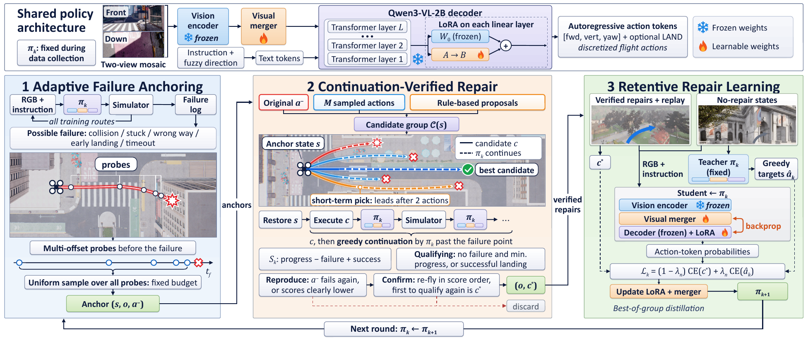

<p align="right">
  <b>English</b> | <a href="./README.zh-CN.md">简体中文</a>
</p>

<div align="center">

<h1>AeroRSI</h1>
<h3>Recursive Self-Improvement for Aerial Vision-Language Navigation</h3>

Shiwei Wu<sup>1</sup> · Yuwen Pan<sup>1</sup> · Zhi Li<sup>1</sup> · Yaowen Li<sup>2</sup> · Yan Zhou<sup>3</sup> · Xuemiao Xu<sup>4</sup> · Yu Liu<sup>2,&dagger;</sup>

<sup>1</sup>Shenzhen International Graduate School, Tsinghua University<br>
<sup>2</sup>Department of Electronic Engineering, Tsinghua University<br>
<sup>3</sup>Foshan University &nbsp;
<sup>4</sup>South China University of Technology &nbsp;
<sup>&dagger;</sup>Corresponding author

<a href="https://arxiv.org/abs/2611.24077"></a>
<a href="https://starsholic.github.io/AeroRSI/"></a>
<a href="https://huggingface.co/papers/2611.24077"></a>
<a href="https://huggingface.co/DavidWu1116/AeroRSI"></a>


<b>The policy judges its own repairs by flying on</b><br>
Five candidates before a crash: only a rule-based climb completes. One round later, the policy climbs by itself.

</div>

## 🔥 News

- `2026.11` Paper on [arXiv](https://arxiv.org/abs/2611.24077); code and [checkpoints](https://huggingface.co/DavidWu1116/AeroRSI) released.

## 💡 TL;DR

A drone navigation policy improves from its own flights, with no extra human labels or inference cost. Before each
failure, it **flies on from every candidate action and learns the ones it completes**; since each repair uncovers the
next failure, it **repeats on the failures that remain**.

<div align="center">

| 46.4% → 67.5% | 38.6% → 19.1% | +10.6 points |
|:-:|:-:|:-:|
| success rate on TravelUAV, three rounds | collision rate | over AeroDPO (prior SOTA baseline) |

</div>

## 🎬 Demos

<p align="center"></p>
<p align="center"><b>Each repair uncovers the next failure</b><br>
One test route: the supervised policy crashes at A, round 1 at B, and round 2 reaches the target.</p>

<p align="center"></p>
<p align="center"><b>The whole test set improves</b><br>
Each square is one of the 3,005 test routes. Success rate 46.4 → 57.6 → 66.0 → 67.5%.</p>

<p align="center"><sub>Every drone is a recorded flight of a policy in TravelUAV; translucent drones are separate flights composited along one camera path. Full video on the <a href="https://starsholic.github.io/AeroRSI/">project page</a>.</sub></p>

## 🌟 Method

<p align="center"></p>

Each round is run by the current policy &pi;<sub>k</sub>:

1. **Adaptive failure anchoring** · [`repair/anchors.py`](aerorsi/repair/anchors.py)<br>
   &pi;<sub>k</sub> flies every training route; anchors are drawn 1–16 actions before each failure.
2. **Continuation-verified repair** · [`repair/verify.py`](aerorsi/repair/verify.py)<br>
   From each anchor, &pi;<sub>k</sub> flies on after every candidate (its own samples and rule-based proposals); one
   that completes twice becomes a repair.
3. **Retentive repair learning** · [`repair/assemble.py`](aerorsi/repair/assemble.py), [`train.py`](aerorsi/train.py)<br>
   &pi;<sub>k+1</sub> learns the repairs, replays earlier ones, and keeps &pi;<sub>k</sub>'s actions at normal states.

## 📊 Results

Success rate (%) on the TravelUAV test splits:

| Method | Seen | Unseen Object | Unseen Map | Overall |
|:--|:-:|:-:|:-:|:-:|
| Supervised policy | 48.38 | 56.44 | 36.85 | 46.39 |
| AeroDPO (prior SOTA baseline) | 60.01 | 66.45 | 45.93 | 56.87 |
| **AeroRSI**, round 1 | 62.62 | 67.89 | 43.42 | 57.60 |
| **AeroRSI**, round 2 | 73.91 | 79.01 | 45.82 | 66.02 |
| **AeroRSI**, round 3 | 75.32 | **82.19** | 46.24 | 67.49 |
| **AeroRSI** from AeroDPO, round 3 | **76.52** | 79.65 | **53.55** | **69.85** |

## 🚀 Quick Start

**1. Environment.** Linux with NVIDIA GPUs (Vulkan for the headless simulator); one simulator worker needs about 9 GB
of GPU memory.

```bash
git clone https://github.com/starsholic/AeroRSI.git && cd AeroRSI
bash scripts/setup_env.sh        # conda env `aerorsi`: PyTorch, Transformers, PEFT, AirSim
conda activate aerorsi
pytest                           # unit tests, CPU only
```

**2. Simulator, data and checkpoints.** Set up TravelUAV as in [AeroVLA](https://github.com/XuPeng23/AeroVLA) and
[AeroDPO](https://github.com/XuPeng23/AeroDPO) following [docs/INSTALL.md](docs/INSTALL.md), then build the route
manifest:

```text
AeroRSI/
├── envs/                             # TravelUAV simulator environments
├── dataset_raw/                      # TravelUAV routes
└── checkpoints/AeroVLA-2B-384-Merged # the supervised policy released by AeroDPO
```

```bash
aerorsi prepare --dataset-root dataset_raw    # 7,611 training and 3,005 test routes
```

**3. Evaluate a policy.** All 3,005 test routes with the benchmark's native actions and termination, about 11 hours on
four GPUs; reports NE, SR, OSR, SPL and CR per split.

```bash
aerorsi evaluate --adapter checkpoints/AeroRSI-2B-SFTinit --output outputs/eval --gpus 0 1 2 3
aerorsi metrics --runs outputs/eval
```

Routes interrupted by a simulator error have no result: fly them again with `--skip-done outputs/eval` into a new
directory and pass both runs to `aerorsi metrics`.

**4. Run the self-improvement loop.** Three rounds from the supervised policy, each evaluated on the test splits;
about 100 GPU hours per round. Stages, outputs and expected numbers are in [docs/REPRODUCE.md](docs/REPRODUCE.md).

```bash
GPUS="0 1 2 3" OUT=outputs/aerorsi bash scripts/run_loop.sh
```

<details>
<summary><b>📁 Repository layout</b></summary>

```text
aerorsi/
├── cli.py               # `aerorsi <stage>`: every stage of the loop and evaluation
├── policy.py            # AeroVLA-2B with a LoRA adapter: inputs, greedy and sampled actions
├── actions.py           # native action text  <->  forward / down / yaw command
├── episode.py           # termination and per-route metrics of the public evaluator
├── flight.py            # fly whole routes (evaluation, and rollouts that keep failures)
├── repair/
│   ├── anchors.py       # 1. adaptive failure anchoring
│   ├── proposals.py     #    rule-based candidates (APF, translate, climb)
│   ├── verify.py        # 2. continuation-verified repair
│   └── assemble.py      # 3. repair pool, current-policy relabels, weighted rows, replay
├── train.py             # 3. weighted supervised training of the next adapter
├── metrics.py           # SR / OSR / SPL / NE / CR, Easy / Hard
├── sim/                 # owned headless simulator, native controller, state save/restore
└── workers.py           # several simulator workers per GPU over a shared route queue
configs/aerorsi.yaml     # every setting of the main experiment
data/                    # official route splits and target spawn areas
scripts/                 # environment setup and the three-round loop
```

</details>

## 📦 Checkpoints

| Policy | Starts from | Overall SR | Download |
|:--|:--|:-:|:--|
| AeroRSI-2B (SFT init.) | the supervised policy AeroVLA-2B-384 | 67.49 | [🤗 AeroRSI-2B-SFTinit](https://huggingface.co/DavidWu1116/AeroRSI/tree/main/AeroRSI-2B-SFTinit) |
| AeroRSI-2B (DPO init.) | AeroDPO | 69.85 | [🤗 AeroRSI-2B-DPOinit](https://huggingface.co/DavidWu1116/AeroRSI/tree/main/AeroRSI-2B-DPOinit) |

LoRA adapters (rank 64, with the visual merger) on the supervised policy `AeroVLA-2B-384-Merged`: place one in
`checkpoints/` and pass it to `--adapter`. To run the loop from AeroDPO, set `INIT=checkpoints/AeroDPO-2B-384-LoRA`
for `scripts/run_loop.sh`.

## 🙏 Acknowledgements

Built on [AeroDPO](https://github.com/XuPeng23/AeroDPO), [AeroVLA](https://github.com/XuPeng23/AeroVLA),
[TravelUAV](https://github.com/prince687028/TravelUAV), [AirSim](https://github.com/microsoft/AirSim) and
[Qwen3-VL](https://github.com/QwenLM/Qwen3-VL). We thank their authors for releasing their work.

## 📌 Citation

```bibtex
@article{wu2026aerorsi,
  title   = {AeroRSI: Recursive Self-Improvement for Aerial Vision-Language Navigation},
  author  = {Wu, Shiwei and Pan, Yuwen and Li, Zhi and Li, Yaowen and Zhou, Yan and Xu, Xuemiao and Liu, Yu},
  journal = {arXiv preprint arXiv:2611.24077},
  year    = {2026}
}
```

## ⭐ Star History

[](https://www.star-history.com/#starsholic/AeroRSI&Date)
