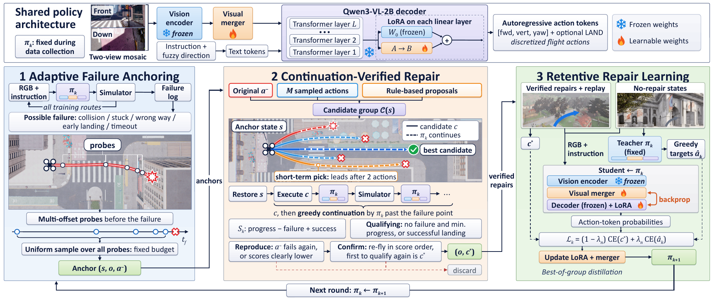

<p align="right">
  <a href="./README.md">English</a> | <b>简体中文</b>
</p>

<div align="center">

<h1>AeroRSI</h1>
<h3>面向空中视觉语言导航的递归自进化</h3>

吴世伟<sup>1</sup> · 潘裕文<sup>1</sup> · 李徵<sup>1</sup> · 李耀文<sup>2</sup> · 周燕<sup>3</sup> · 徐雪妙<sup>4</sup> · 刘瑜<sup>2,&dagger;</sup>

<sup>1</sup>清华大学深圳国际研究生院 &nbsp;
<sup>2</sup>清华大学电子工程系 &nbsp;
<sup>3</sup>佛山大学 &nbsp;
<sup>4</sup>华南理工大学 &nbsp;
<sup>&dagger;</sup>通讯作者

<a href="https://arxiv.org/abs/2611.24077"></a>
<a href="https://starsholic.github.io/AeroRSI/"></a>
<a href="https://huggingface.co/papers/2611.24077"></a>
<a href="https://huggingface.co/DavidWu1116/AeroRSI"></a>


<b>模型通过继续飞行检验自己的修复</b><br>
撞毁前的 5 个候选动作中，只有规则提案“爬升”能够飞完；训练一轮后，模型自己就会爬升。

</div>

## 🔥 动态

- `2026.11` 论文发布于 [arXiv](https://arxiv.org/abs/2611.24077)，同时开源代码和[模型权重](https://huggingface.co/DavidWu1116/AeroRSI)。

## 💡 TL;DR

无人机导航模型从自身飞行中自进化：每次失败之前，模型**从每个候选动作出发继续飞行，学习能够飞完的动作**；修复一处失败会暴露其后的失败，因此**逐轮针对剩余的失败重复这一过程**。全程不需要额外人工标注，也不增加推理开销。

<div align="center">

| 46.4% → 67.5% | 38.6% → 19.1% | +10.6 个点 |
|:-:|:-:|:-:|
| TravelUAV 测试成功率，迭代三轮 | 碰撞率 | 超过 AeroDPO（此前最优基线） |

</div>

## 🎬 演示

<p align="center"></p>
<p align="center"><b>每次修复都会暴露下一处失败</b><br>
同一条测试路线：监督学习模型在 A 处撞毁，迭代一轮后在 B 处撞毁，迭代两轮后到达目标。</p>

<p align="center"></p>
<p align="center"><b>整个测试集逐轮提升</b><br>
每个方块是 3,005 条测试路线中的一条；成功率 46.4 → 57.6 → 66.0 → 67.5%。</p>

<p align="center"><sub>画面中的无人机均为模型在 TravelUAV 中的实际飞行记录；半透明的无人机是分别录制、沿同一机位合成的飞行。完整视频见<a href="https://starsholic.github.io/AeroRSI/">项目主页</a>。</sub></p>

## 🌟 方法

<p align="center"></p>

每一轮都由当前模型 &pi;<sub>k</sub> 完成：

1. **自适应失败锚定** · [`repair/anchors.py`](aerorsi/repair/anchors.py)<br>
   &pi;<sub>k</sub> 飞完全部训练路线，在每次失败前 1–16 个动作处选取锚点。
2. **续飞验证修复** · [`repair/verify.py`](aerorsi/repair/verify.py)<br>
   在每个锚点上，&pi;<sub>k</sub> 从每个候选动作（自身采样与规则提案）出发继续飞行，两次都能飞完的候选成为修复。
3. **保持式修复学习** · [`repair/assemble.py`](aerorsi/repair/assemble.py)、[`train.py`](aerorsi/train.py)<br>
   &pi;<sub>k+1</sub> 学习本轮的修复，回放此前的修复，并在正常状态上保持 &pi;<sub>k</sub> 自己的动作。

## 📊 结果

TravelUAV 测试集成功率（%）：

| 方法 | 已见 | 未见物体 | 未见地图 | 总体 |
|:--|:-:|:-:|:-:|:-:|
| 监督学习模型 | 48.38 | 56.44 | 36.85 | 46.39 |
| AeroDPO（此前最优基线） | 60.01 | 66.45 | 45.93 | 56.87 |
| **AeroRSI**，迭代 1 轮 | 62.62 | 67.89 | 43.42 | 57.60 |
| **AeroRSI**，迭代 2 轮 | 73.91 | 79.01 | 45.82 | 66.02 |
| **AeroRSI**，迭代 3 轮 | 75.32 | **82.19** | 46.24 | 67.49 |
| **AeroRSI** 从 AeroDPO 起步，迭代 3 轮 | **76.52** | 79.65 | **53.55** | **69.85** |

## 🚀 快速开始

<b>1. 环境。</b>需要 Linux 和 NVIDIA GPU（无头模拟器通过 Vulkan 渲染）；每个模拟器 worker 约占 9 GB 显存。

```bash
git clone https://github.com/starsholic/AeroRSI.git && cd AeroRSI
bash scripts/setup_env.sh        # conda 环境 `aerorsi`：PyTorch、Transformers、PEFT、AirSim
conda activate aerorsi
pytest                           # 单元测试，只用 CPU
```

<b>2. 模拟器、数据和权重。</b>按 [docs/INSTALL.md](docs/INSTALL.md) 配置 TravelUAV，设置与 [AeroVLA](https://github.com/XuPeng23/AeroVLA)、[AeroDPO](https://github.com/XuPeng23/AeroDPO) 相同，然后生成路线清单：

```text
AeroRSI/
├── envs/                             # TravelUAV 模拟器环境
├── dataset_raw/                      # TravelUAV 路线
└── checkpoints/AeroVLA-2B-384-Merged # AeroDPO 发布的监督学习模型
```

```bash
aerorsi prepare --dataset-root dataset_raw    # 7,611 条训练路线、3,005 条测试路线
```

<b>3. 评测模型。</b>用基准原生的动作和终止规则飞完全部 3,005 条测试路线，4 张卡约 11 小时；按划分报告 NE、SR、OSR、SPL 和 CR。

```bash
aerorsi evaluate --adapter checkpoints/AeroRSI-2B-SFTinit --output outputs/eval --gpus 0 1 2 3
aerorsi metrics --runs outputs/eval
```

因模拟器错误中断的路线没有结果：用 `--skip-done outputs/eval` 把这些路线重新飞到新目录，再把两次结果一起传给 `aerorsi metrics`。

<b>4. 运行自进化循环。</b>从监督学习模型起步迭代三轮，每轮都在测试集上评测；每轮约 100 GPU 小时。各阶段、输出和预期结果见 [docs/REPRODUCE.md](docs/REPRODUCE.md)。

```bash
GPUS="0 1 2 3" OUT=outputs/aerorsi bash scripts/run_loop.sh
```

<details>
<summary><b>📁 目录结构</b></summary>

```text
aerorsi/
├── cli.py               # `aerorsi <阶段>`：循环的每个阶段和评测
├── policy.py            # 带 LoRA adapter 的 AeroVLA-2B：输入构造、贪心与采样动作
├── actions.py           # 原生动作文本 <-> 前进 / 下降 / 偏航指令
├── episode.py           # 公开评测器的终止规则和逐路线指标
├── flight.py            # 飞完整条路线（评测，以及保留失败现场的 rollout）
├── repair/
│   ├── anchors.py       # 1. 自适应失败锚定
│   ├── proposals.py     #    规则候选（APF、平移、爬升）
│   ├── verify.py        # 2. 续飞验证修复
│   └── assemble.py      # 3. 修复池、当前模型重标、加权训练行、回放
├── train.py             # 3. 下一轮 adapter 的加权监督训练
├── metrics.py           # SR / OSR / SPL / NE / CR，Easy / Hard
├── sim/                 # 自管的无头模拟器、原生控制器、状态保存与恢复
└── workers.py           # 每卡多个模拟器 worker，共享路线队列
configs/aerorsi.yaml     # 主实验的全部设置
data/                    # 官方路线划分和目标出生区域
scripts/                 # 环境安装和三轮循环脚本
```

</details>

## 📦 模型权重

| 模型 | 起点 | 总体 SR | 下载 |
|:--|:--|:-:|:--|
| AeroRSI-2B（SFT init.） | 监督学习模型 AeroVLA-2B-384 | 67.49 | [🤗 AeroRSI-2B-SFTinit](https://huggingface.co/DavidWu1116/AeroRSI/tree/main/AeroRSI-2B-SFTinit) |
| AeroRSI-2B（DPO init.） | AeroDPO | 69.85 | [🤗 AeroRSI-2B-DPOinit](https://huggingface.co/DavidWu1116/AeroRSI/tree/main/AeroRSI-2B-DPOinit) |

两者都是加载在监督学习模型 `AeroVLA-2B-384-Merged` 之上的 LoRA adapter（rank 64，含 visual merger）：放进 `checkpoints/` 后传给 `--adapter`。要从 AeroDPO 起步运行循环，给 `scripts/run_loop.sh` 设置 `INIT=checkpoints/AeroDPO-2B-384-LoRA`。

## 🙏 致谢

本工作基于 [AeroDPO](https://github.com/XuPeng23/AeroDPO)、[AeroVLA](https://github.com/XuPeng23/AeroVLA)、[TravelUAV](https://github.com/prince687028/TravelUAV)、[AirSim](https://github.com/microsoft/AirSim) 和 [Qwen3-VL](https://github.com/QwenLM/Qwen3-VL)，感谢这些工作的作者公开代码与模型。

## 📌 引用

```bibtex
@article{wu2026aerorsi,
  title   = {AeroRSI: Recursive Self-Improvement for Aerial Vision-Language Navigation},
  author  = {Wu, Shiwei and Pan, Yuwen and Li, Zhi and Li, Yaowen and Zhou, Yan and Xu, Xuemiao and Liu, Yu},
  journal = {arXiv preprint arXiv:2611.24077},
  year    = {2026}
}
```

## ⭐ Star History

[](https://www.star-history.com/#starsholic/AeroRSI&Date)
